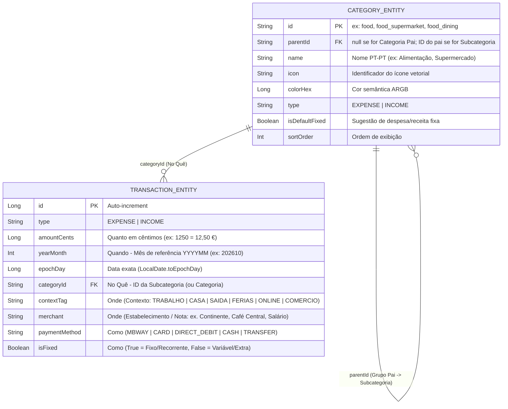

# Plano de Arquitetura & Solução Completa — AppAndroid Finanças Pessoais

> Documento consolidado após sessão de alinhamento (`/grill-me`). Define as causas raiz, a solução mais simples possível, a configuração de skills/ferramentas, o modelo de dados de 4 dimensões e a especificação funcional dos ecrãs.

---

## 1. Diagnóstico de Especialista: As 4 Causas Raiz

1. **Causa Raiz 1 — Colapso Dimensional (*No Quê* vs. *Onde* vs. *Como*):**
   As apps tradicionais misturam categorias (*Alimentação*), contextos/locais (*Trabalho, Férias, Café Central*) e métodos (*MB Way, Fixas*) numa única lista.
   * **Solução:** Separar cada movimento em **4 dimensões ortogonais** na mesma transação:
     * **Quanto & Quando:** Valor em cêntimos (`Long`) + Data (`yearMonth` e `epochDay`).
     * **No Quê (`Categoria Pai > Subcategoria`):** Hierarquia de 2 níveis (ex: *Alimentação > Supermercado*, *Alimentação > Restaurantes/Almoços*, *Transportes > Combustível*).
     * **Onde (`Contexto/Local` + `Estabelecimento/Nota`):** Chips de contexto (*Trabalho, Casa, Saída, Férias, Online, Comércio*) combinados com o estabelecimento/nota (*Continente, Café Central, Galp*).
     * **Como (`Meio de Pagamento` + `Rigidez`):** Método (*MB Way, Cartão, Débito Direto, Dinheiro, Transferência*) + flag booleana (*Fixo/Recorrente* vs. *Variável*).

2. **Causa Raiz 2 — O Paradoxo do Registo (A "Regra dos 3 Segundos"):**
   Pedir 5 campos manuais em cada compra leva ao abandono da app.
   * **Solução (Motor de Memória Associativa):** Quando o utilizador escolhe ou toca numa sugestão de **Estabelecimento/Nota** (ex: `Café Central` ou `Continente`) ou num **Contexto**, a app pré-seleciona automaticamente a **Categoria > Subcategoria**, o **Contexto (`Onde`)**, o **Meio de Pagamento (`Como`)** e se é **Fixo/Variável** com base no último movimento semelhante.

3. **Causa Raiz 3 — Cegueira de Valores Absolutos vs. Relação com o Rendimento:**
   Olhar para `250 €` isolados não diz o impacto no orçamento mensal.
   * **Solução (Rendimento Mensal como Base 100%):** O total recebido no mês (Salário Base + Extras/Subsídios/Reembolsos) é o denominador (`100%`) de toda a app. Todos os ecrãs e gráficos possuem um interruptor instantâneo **`[ € | % do que Recebo ]`** e comparam automaticamente o mês atual com a **Média Mensal histórica**.

4. **Causa Raiz 4 — Fricção no Virar do Mês:**
   Ter de voltar a digitar o Salário Base e as 6–8 despesas fixas (renda, água, luz, ginásio, subscrições) todos os meses é trabalho repetitivo desnecessário.
   * **Solução (Sugestão de 1 Toque no Novo Mês):** Ao abrir um mês novo ainda sem movimentos fixos, a app mostra um cartão de 1 toque: *"Gerar Salário Base e X Despesas Fixas do mês anterior?"*, permitindo confirmar ou ajustar qualquer valor em segundos.

---

## 2. Configuração Mínima de Skills e Ferramentas

### Skills Necessárias (Fluxo *Planeador → Executor → Validador*)
1. **`agents-md-writer`** — Define as regras operacionais em [`AGENTS.md`](./AGENTS.md).
2. **`sprint-contract`** — Governa a execução através de [`GOAL_DECOMPOSITION.md`](./GOAL_DECOMPOSITION.md) e dos 4 contratos em [`contracts/`](./contracts/).
3. **`frontend-design`** — Garante UI Dark Mode de nível Revolut/Copilot e gráficos nativos em Compose `Canvas`.
4. **`code-review`** — Valida cada sprint contra os critérios `MUST` (Tier 3/4) antes de qualquer commit.

### Stack Técnica Mínima (Zero Bloat)
* **Linguagem & UI:** Kotlin 2.4 + Jetpack Compose (Material 3, Dark Mode exclusivo).
* **Base de Dados:** Room 2.6+ (SQLite local, sem necessidade de servidor externo).
* **Injeção de Dependências:** `AppContainer` manual em Kotlin puro (zero atraso de compilação de KAPT/Hilt).
* **Gráficos:** Compose `Canvas` nativo (0 bibliotecas externas de gráficos).
* **Segurança & Backup:** Abertura instantânea por defeito + `AndroidX Biometric` opcional (switch na aba `Conta`) + Exportação/Importação em `JSON` e `CSV` via Storage Access Framework (SAF).

---

## 3. Modelo de Dados Relacional (Room SQLite)



### Categorias e Subcategorias Predefinidas (Editáveis pelo Utilizador)

* **Receitas (`INCOME`):**
  * `Rendimento Fixo` → *Salário Base*, *Subsídio de Alimentação*
  * `Rendimento Extra` → *Prémios / Bónus*, *Subsídio Férias/Natal*, *Reembolsos / MB Way*, *Outros Rendimentos*
* **Gastos (`EXPENSE` — 8 Grupos Pais → Subcategorias):**
  1. **Habitação & Contas** → *Renda / Prestação*, *Eletricidade & Gás*, *Água*, *Internet & Telecom*, *Manutenção Casa*
  2. **Alimentação** → *Supermercado*, *Almoços / Trabalho*, *Restaurantes & Jantares*, *Cafés & Pastelaria*
  3. **Transportes** → *Combustível*, *Portagens & Estacionamento*, *Transportes Públicos / TVDE*, *Manutenção & Seguro Auto*
  4. **Saúde & Bem-Estar** → *Consultas & Exames*, *Farmácia*, *Ginásio & Desporto*, *Cuidados Pessoais*
  5. **Lazer & Social** → *Saídas & Bares*, *Cultura & Eventos*, *Subscrições Digitais*, *Hobbies*
  6. **Compras & Educação** → *Roupa & Calçado*, *Tecnologia & Equipamento*, *Formação & Livros*, *Prendas*
  7. **Férias & Viagens** → *Alojamento*, *Voos & Deslocações*, *Atividades & Refeições em Viagem*
  8. **Financeiro & Outros** → *Poupança / Investimento*, *Impostos & Taxas*, *Outros / Imprevistos*

### Contextos `"Onde"` Predefinidos (Editáveis/Expansíveis)
`Trabalho` · `Casa` · `Saída / Social` · `Férias / Viagem` · `Online` · `Comércio / Rua`

### Meios de Pagamento `"Como"`
`MB Way` · `Cartão` · `Débito Direto` · `Transferência` · `Dinheiro` (+ Flag `Fixo/Recorrente` vs. `Variável`)

---

## 4. Arquitetura de Navegação (5 Pontos) e Ecrãs

```text
+-----------------------------------------------------------------------------------+
|  [ 🏠 Início ]    [ 🧾 Movimentos ]    ( ➕ )    [ 📊 Análise ]    [ ⚙️ Conta ]   |
+-----------------------------------------------------------------------------------+
```

### 1. `🏠 Início` (Cockpit Mensal & Alocação do Rendimento)
* **Seletor `< Mês Ano >` de 1 Toque** no topo.
* **Banner de Início de Mês (quando aplicável):** Botão de 1 toque *"Gerar Salário Base e Despesas Fixas do mês anterior"* com revisão rápida.
* **Hero Card — Relação Gasto vs. Recebido:**
  * **Recebido Total:** `€` (100%) dividido em *Base* + *Extras*.
  * **Gasto Total:** `€` + **`% do que recebeste`** + comparação com a tua Média Mensal (ex: `▼ -8% vs. média`).
  * **Poupança Líquida:** `Recebido - Gasto` em `€` e **Taxa de Poupança `%`**.
  * **Barra de Esforço Tripartida (100% do Rendimento):**
    `[ 🔒 Fixos (% do recebido) | ⚡ Variáveis (% do recebido) | 🌱 Poupado (% do recebido) ]`
* **Resumo Rápido "Onde vai o dinheiro este mês":** Top 3 Categorias e Top 3 Contextos (`Onde`) clicáveis + Últimos 5 movimentos.

### 2. `🧾 Movimentos` (Feed Global + Pesquisa Instantânea + Filtros)
* **Barra de Pesquisa em Tempo Real:** Pesquisa por estabelecimento/nota (`"Café Central"`, `"Continente"`), subcategoria ou contexto.
* **Cartão de Soma Dinâmica do Filtro:** Mostra sempre `X movimentos · Total: Y,YY € (Z% do recebido no período)`.
* **Filtros Rápidos em Cápsulas:**
  * Período (`Mês Atual`, `Ano`, `Tudo`)
  * Fluxo/Rigidez (`Todos`, `Fixos`, `Variáveis`, `Receitas`)
  * Contexto `Onde` (`Trabalho`, `Casa`, `Saída`, `Férias`, `Online`)
  * Método `Como` (`MB Way`, `Cartão`, `Débito Direto`, `Dinheiro`)
* **Lista Agrupada por Data** com edição/remoção ao toque.

### 3. `( ➕ )` Botão Central — Registo Ultra-Rápido em < 3 Segundos
* **Toggle Superior:** `[ 💸 Gasto | 💰 Receita ]`
* **Visor + Teclado Calculadora Escuro (`CalculatorNumpad`):** Permite digitar valores ou somar inline (`12,50 + 4,00`) sem abrir o teclado branco do Android.
* **Sugestões de Estabelecimento / Nota (Auto-Prefill):** Ao tocar num chip recente (ex: `Continente`, `Galp`, `Café Central`, `Salário`), preenche automaticamente a **Categoria > Subcategoria**, o **Contexto (`Onde`)**, o **Método (`Como`)** e a flag **Fixo/Variável**.
* **Seletores Rápidos de 1 Toque:**
  * **No Quê:** Categoria Principal → Subcategoria.
  * **Onde:** Chips de Contexto (`Trabalho`, `Casa`, `Saída`, `Férias`, `Online`, `Comércio`).
  * **Como:** Chips de Método (`MB Way`, `Cartão`, `Débito Direto`, `Dinheiro`, `Transferência`) + Switch `🔁 Fixo`.

### 4. `📊 Análise` (4 Vistas Interativas com Toggle `[ € | % do que Recebo ]`)
* **Cabeçalho Global:** Seletor `< Mês Ano >` (ou `< Ano >`) + Interruptor **`[ € | % do Recebido ]`**.
* **Vista 1 — `No Quê` (Categorias & Subcategorias):**
  * Donut Interativo em `Canvas` + Lista ordenada por peso no rendimento.
  * Tocar num Grupo Pai (ex: *Alimentação — 22% do salário*) expande/filtra as suas Subcategorias (*Supermercado 14%*, *Almoços 8%*) e mostra o desvio face à tua Média Mensal.
* **Vista 2 — `Onde` (Contextos & Top Estabelecimentos):**
  * Gráfico de barras horizontais por **Contexto** (*Quanto do meu salário gasto em Trabalho vs. Casa vs. Saídas vs. Online vs. Férias*).
  * Ranking **Pareto Top 10 Estabelecimentos** (*Onde deixo mais dinheiro, nº de vezes no mês e valor médio por ida*).
* **Vista 3 — `Como` (Rigidez & Meios de Pagamento):**
  * Estrutura **Gastos Fixos vs. Gastos Variáveis** (% do rendimento comprometido à partida vs. margem de manobra).
  * Breakdown por **Meio de Pagamento** (`MB Way`, `Cartão`, `Débito Direto`, `Transferência`, `Dinheiro`).
* **Vista 4 — `Evolução` (Análise Anual Mês a Mês):**
  * Gráfico de barras interativo ao toque (`Touch Scrubber`) de **Recebido vs. Gasto por Mês** + **Linha de Média Mensal** + curva da **Taxa de Poupança (%)**.

### 5. `⚙️ Conta` (Categorias, Biometria Opcional e Backup)
* **Gestão de Categorias/Subcategorias e Contextos:** Adicionar, editar ou reordenar.
* **Segurança Opcional:** Switch `"Pedir Biometria ao abrir a app"` (desligado por defeito para máxima velocidade).
* **Backup & Portabilidade:** Exportar tudo para `JSON` (backup completo) ou `CSV` (compatível com Excel) e Importar backup com validação atómica.
